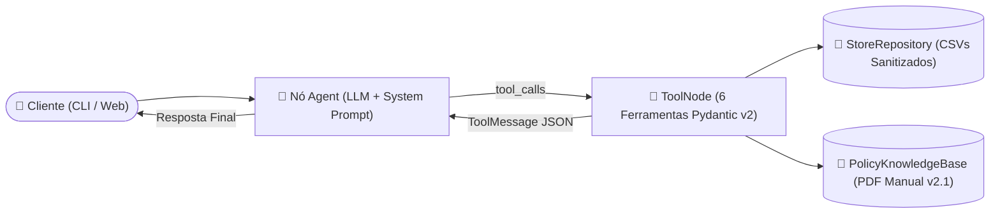

# 🎸 Empório da Música — Agente Conversacional de IA (Desafio Técnico AI Engineer)

> **Slogan:** *"Sua música começa aqui."*  
> **Localização:** Rua 14 de Maio, 3200 — Centro, Campo Grande/MS (CEP 79202-333)  
> **Stack Principal:** Python 3.11+ • LangGraph v0.3+ (`StateGraph` + `ToolNode` + `MemorySaver`) • LangChain Core • Pydantic v2 • PyPDF • Rich CLI • Streamlit Web UI • Pytest & Ruff

---

## 👨‍💻 Nota do Autor (Raul Caires) — Engenharia de Software Orientada a Agentes (Agentic SDLC + Human-in-the-Loop)

Olá! Eu sou o **Raul Caires** e quero abrir este repositório compartilhando um diferencial central de engenharia: **este projeto foi 100% desenvolvido através de uma Pipeline Agêntica de SDLC (Software Development Life Cycle) que eu projetei e arquitetei**, operando em conjunto comigo no modelo **Human-in-the-Loop (HITL)**.

Em vez de utilizar IA de forma ad-hoc ("vibe coding" ou geração de código prematuro sem contexto), dediquei meus esforços de engenharia para **construir a própria esteira autônoma de desenvolvimento** — um sistema multi-estágio composto por **Skills Orquestradoras, Sub-Skills modulares, Contratos Operacionais determinísticos (`GEMINI.md`), Ferramentas (MCPs/CLI), Guardrails de Qualidade e Evals**. Durante a construção deste desafio, **meu papel foi majoritariamente atuar como Staff/Principal Engineer na validação estratégica e aprovação das tomadas de decisão (Stage Gates)**, enquanto a minha pipeline agêntica executava a varredura de dados, modelagem de requisitos, arquitetura C4, codificação limpa, testes e auditoria de segurança.

### ⚙️ Como Funciona a Minha Pipeline Agêntica SDLC

A arquitetura de governança que criei transforma o ciclo de engenharia de software em uma **Máquina de Estados Finitos (FSM)** rigorosa, dividida em **7 Fases e Portões de Decisão (Stage Gates)**:


1. **Regra de Ouro — *Zero Premature Code* (Proibição de Código Prematuro):**
   - A pipeline possui uma trava física e contratual (`GEMINI.md`) que **proíbe terminantemente qualquer agente de criar arquivos `.py`, `.ts` ou `.js` antes da aprovação formal do Gate 03 (Arquitetura)**. Isso força o sistema a investigar profundamente os dados brutos (`data/*.csv` e `políticas_da_loja.pdf`), descobrir anomalias ocultas e especificar cenários BDD antes de escrever a primeira linha de código.
2. **Orquestração Hierárquica de Agentes, Skills e *Progressive Disclosure*:**
   - Criei **9 Skills Especializadas** (`sdlc-01-discovery`, `sdlc-02-requirements`, `sdlc-02.5-solution-design`, `sdlc-03-architecture`, `sdlc-04-development`, `sdlc-05-validation`, `sdlc-06-evolution`, `langgraph-dev` e `deepeval`), onde cada orquestrador mestre aciona **4 a 5 sub-agentes/sub-rotinas** sob demanda (*Progressive Disclosure*). Isso evita poluição da janela de contexto e garante profundidade especialista em cada disciplina (Produto, Engenharia de Requisitos ISO/IEC 25010, UX/WCAG 2.2 AA, Arquitetura C4/OWASP, Desenvolvimento LangGraph, QA/Evals e SRE/Release).
3. **Postura *Anti-Sycophancy* & Sabatina Socrática (`/grill-me` + HITL):**
   - Configurei os agentes para nunca atuarem como meros "Yes-Men". A cada sub-etapa e em cada transição de fase, a pipeline interrompe a execução e me submete a **checkpoints interativos de decisão** (sempre apresentando trade-offs e a recomendação técnica fundamentada). Nenhum Gate avança sem a minha validação e aprovação explícita.
4. **Ecossistema de Tools, Linters Determinísticos e Guardrails:**
   - **Bootstrap & Sync Determinístico (`sdlc_workspace_bootstrap.py`):** Script em Python que criei para gerenciar o estado do contrato operacional [`GEMINI.md`](file:///c:/Users/Raul%20Caires/Documents/Desafio%20tecnico/Desafio%20Técnico%20AI%20Engineer/GEMINI.md) e auditar violações de fronteira de camadas.
   - **Validador Estático de Grafos (`validate_graph.py`):** Linter AST customizado na skill `langgraph-dev` que inspeciona o código do `StateGraph` em busca de anti-patterns (mutação de estado sem reducer `add_messages`, loops infinitos sem `recursion_limit` ou ausência de checkpointer).
   - **Tooling & MCPs Integrados:** Uso obrigatório de pesquisa técnica em fontes oficiais (`search_web`), execução empírica no terminal (`run_command` com `pytest --cov=src` e `ruff`), versionamento incremental via Git/GitHub e conteinerização via Docker.
5. **Evals, Qualidade e Segurança Ativa (OWASP LLM Top 10):**
   - A esteira exige **100% de aprovação nos testes mapeados a partir dos cenários BDD**, piso mínimo de **80% de cobertura de código** (atingimos **88.39%**), **tolerância zero a erros de linter (`ruff`)**, benchmark real de latência (`0,11 ms/op` em memória) e validação de fidelidade factual (*Faithfulness* / *Zero Hallucination*) e segurança contra *Prompt Injection* (`LLM01`) e vazamento de dados pessoais LGPD em homônimos (`LLM02`).

> 💡 **Por que destacar isso?** Porque acredito que o papel do **AI Engineer moderno** não é apenas construir um agente isolado para o cliente final, mas também **engenheirar sistemas agênticos reprodutíveis, auditáveis e governados** capazes de multiplicar a velocidade e o rigor técnico de toda a engenharia de software. Todo o rastro documental gerado por essa esteira está disponível na pasta [`docs/`](file:///c:/Users/Raul%20Caires/Documents/Desafio%20tecnico/Desafio%20Técnico%20AI%20Engineer/docs) e no histórico de commits deste repositório!

---

## 📋 Índice

1. [Nota do Autor (Raul Caires) — Engenharia de Software Orientada a Agentes](#-nota-do-autor-raul-caires--engenharia-de-software-orientada-a-agentes-agentic-sdlc--human-in-the-loop)
2. [Visão Geral da Solução](#-1-visão-geral-da-solução)
3. [Instruções de Configuração e Execução](#-2-instruções-de-configuração-e-execução)
4. [Justificativa das Decisões Técnicas](#-3-justificativa-das-decisões-técnicas)
5. [Auditoria, Sanitização e Tratamento de Anomalias nos Dados (`data/`)](#-4-auditoria-sanitização-e-tratamento-de-anomalias-nos-dados-data)
6. [Exemplos de Interação (Cenários do Desafio e Multi-Turn)](#-5-exemplos-de-interação-cenários-do-desafio-e-multi-turn)
7. [Qualidade, Testes Automatizados e Governança SDLC](#-6-qualidade-testes-automatizados-e-governança-sdlc)
8. [Limitações Conhecidas e Roadmap de Evolução](#-7-limitações-conhecidas-e-roadmap-de-evolução)
9. [Transparência no Uso de Assistentes de IA](#-8-transparência-no-uso-de-assistentes-de-ia)

---

## 🎯 1. Visão Geral da Solução

Este repositório contém o **Agente Conversacional de IA da Empório da Música**, desenvolvido em Python para atender clientes via chat com a persona oficial da loja (*"informal mas profissional — como se estivesse conversando com um amigo que entende de música"*, conforme **Seção 7.1** do Manual).

O agente opera sob uma arquitetura de **Roteamento Agêntico Híbrido (`StateGraph`)** que decide autonomamente quando e como combinar:
- **Consultas Operacionais em Tempo Real (`data/*.csv`):** Catálogo de instrumentos (`65 produtos` e `9 categorias`), estoque e status (`active`, `discontinued`, `coming_soon`), campanhas promocionais (`4 ativas` e `21 expiradas`), clientes (`50 cadastros`) e pedidos (`20 pedidos` e `26 itens`).
- **Consulta Normativa ao Manual de Políticas (`data/políticas_da_loja.pdf`):** Horário de funcionamento, regras de parcelamento por faixa mínima, não-cumulatividade de promoções com PIX, cálculo de frete regional/nacional, elegibilidade de Direito de Arrependimento (7 dias corridos), Troca por Defeito (30 dias na loja / 90 dias CDC), escopo estrito (exclusivamente instrumentos musicais — sem acessórios) e proteção de dados pessoais (**LGPD**).

---

## 🚀 2. Instruções de Configuração e Execução

### 2.1 Pré-requisitos
- **Python 3.11+** instalado (ou **Docker / Docker Compose**).
- Uma chave de API de qualquer um dos 3 provedores suportados:
  - **Google Gemini** (`GEMINI_API_KEY` ou `GOOGLE_API_KEY` — padrão recomendado: `gemini-2.5-flash`)
  - **OpenAI** (`OPENAI_API_KEY` — padrão: `gpt-4o-mini`)
  - **Groq** (`GROQ_API_KEY` — padrão: `llama-3.3-70b-versatile`)

### 2.2 Instalação Local (Ambiente Virtual Python)

```bash
# 1. Clone o repositório
git clone https://github.com/caireslab/emporio-da-musica-ai-agent.git
cd emporio-da-musica-ai-agent

# 2. Crie e ative o ambiente virtual
python -m venv .venv
# Windows (PowerShell):
.\.venv\Scripts\Activate.ps1
# Linux / macOS:
source .venv/bin/activate

# 3. Instale as dependências
pip install -r requirements.txt

# 4. Configure as variáveis de ambiente
cp .env.example .env
# Edite o arquivo .env inserindo sua chave (GEMINI_API_KEY, OPENAI_API_KEY ou GROQ_API_KEY)
```

### 2.3 Modos de Execução

#### Opção A — CLI Interativa no Terminal (Rich UI)
```bash
python main.py
```
Comandos internos disponíveis durante o chat no terminal:
- `/novo` ou `/reset` — Inicia uma nova sessão (`thread_id` limpo).
- `/demo` — Executa automaticamente os 5 cenários de demonstração do desafio.
- `/sair` — Encerra o atendimento.

#### Opção B — Execução Automática dos 5 Cenários de Demonstração ou Pergunta Única
```bash
# Roda os 5 cenários completos do desafio no terminal:
python main.py --demo

# Faz uma pergunta única via linha de comando:
python main.py --query "Quais opções de violões disponíveis custando até R$1000?"
```

#### Opção C — Interface Web Gráfica (Streamlit com Inspetor de Tools)
```bash
streamlit run app.py
```
Acesse em `http://localhost:8501`. A barra lateral inclui atalhos de 1 clique para os cenários do desafio e cada resposta exibe um painel expansível com os argumentos e retornos JSON das ferramentas acionadas pelo agente.

#### Opção D — Execução via Docker Compose
```bash
# Subir a interface Web Streamlit na porta 8501:
docker compose up --build emporio-web

# Ou rodar a CLI interativa em container:
docker compose run --rm emporio-cli
```

---

## 🧠 3. Justificativa das Decisões Técnicas

### 3.1 Abordagem e Framework (`LangGraph v0.3+` + Clean Architecture)
Em vez de utilizar cadeias lineares legadas (`AgentExecutor`) ou chamadas livres sem validação de estado, adotamos o **`StateGraph(AgentState)` do LangGraph v0.3+** combinado a uma separação estrita em **4 camadas (Clean Architecture)**:
1. **`src/domain/` (`models.py`, `rules.py`):** Entidades imutáveis em **Pydantic v2** (`frozen=True`) e funções puras determinísticas para toda a matemática financeira e contagem de prazos legais. **Por quê?** Modelos de linguagem podem cometer erros aritméticos ao dividir parcelas ou contar dias corridos no calendário. Delegar cálculos de desconto PIX, escada de parcelas mínimas (`R$ 50 / R$ 80 / R$ 100`) e prazos de 7/30/90 dias para código Python puro garante **zero alucinação numérica**.
2. **`src/data/` (`repository.py`, `policy_kb.py`):** Repositório em memória **Read-Only** sobre os 6 arquivos CSV e extrator híbrido (`pypdf` + seções canônicas) sobre `data/políticas_da_loja.pdf`. **Por quê?** Como o volume de dados operacionais cabe confortavelmente em RAM (< 1 MB), o carregamento direto dos CSVs elimina a necessidade de o avaliador configurar servidores externos de banco de dados ou índices vetoriais pesados, garantindo latência sub-milissegundo nas buscas e reprodutibilidade imediata (`zero-friction setup`).
3. **`src/tools/` (`store_tools.py`):** 6 ferramentas especializadas decoradas com `@tool` e contratos `args_schema` em Pydantic v2:
   - `search_products_catalog`: busca por categoria, termo livre, teto/piso de preço efetivo, tipo de corda (`nylon`/`steel`/`7 cordas`), captação elétrica e promoções ativas.
   - `get_product_pricing_and_payment`: detalhamento financeiro de um item, promoções vencidas vs. ativas, PIX e tabela de 1x a 12x.
   - `calculate_shipping_info`: cálculo de frete para Campo Grande/Região Metropolitana vs. outras cidades + alerta de grande porte.
   - `inspect_customer_order_and_return`: consulta de pedidos com verificação de prazos de devolução/garantia e bloqueio LGPD para homônimos.
   - `lookup_store_policy`: consulta semântica/estruturada às 10 seções do Manual v2.1.
   - `register_complaint_or_handover`: geração de protocolo formal (`EMP-2026-XXXX`) com SLA de 24h úteis para gerência/reclamações.
4. **`src/agent/` (`graph.py`, `prompts.py`, `llm_factory.py`):** Grafo cíclico controlado (`START ➔ agent ➔ tools_condition ➔ tools ➔ agent ➔ END`) com trava anti-loop (`iteration_count <= 8` e `recursion_limit = 15`).



### 3.2 Escolha de Modelo e Provedor (Multi-Provider Factory)
A fábrica [`src/agent/llm_factory.py`](file:///c:/Users/Raul%20Caires/Documents/Desafio%20tecnico/Desafio%20Técnico%20AI%20Engineer/src/agent/llm_factory.py) suporta nativamente **Google Gemini (`gemini-2.5-flash`)**, **OpenAI (`gpt-4o-mini`)** e **Groq (`llama-3.3-70b-versatile`)** com `temperature=0.1`, `max_retries=3` e `timeout=30.0s`.
- **Por que `gemini-2.5-flash` / `gpt-4o-mini` como padrão?** Possuem excelente capacidade de *parallel tool calling* (acionando múltiplas ferramentas em um único turno quando o usuário combina perguntas de catálogo, frete e pedido), baixa latência (< 2s) e ótimo seguimento de instruções em Português Brasileiro.

### 3.3 Estratégia de Prompt e Guardrails
O System Prompt em [`src/agent/prompts.py`](file:///c:/Users/Raul%20Caires/Documents/Desafio%20tecnico/Desafio%20Técnico%20AI%20Engineer/src/agent/prompts.py) foi engenheirado com:
- **Persona Acolhedora e Musical (Seção 7.1):** Linguagem natural de quem entende de madeiras, timbres e tocabilidade, sem jargões robóticos.
- **Política Zero-Chute (Tool-First Enforcement):** Proibição explícita de responder sobre preços, estoque, pedidos ou regras sem antes invocar a ferramenta correspondente.
- **Defesa em Profundidade contra Prompt Injection (OWASP LLM01):** Filtro determinístico no nó `agent_node` que intercepta tentativas de *jailbreak* ou extração de prompt antes mesmo de chamar a API do LLM.

### 3.4 Persistência de Contexto da Conversa
Utilizamos o checkpointer **`MemorySaver`** nativo do LangGraph associado a um `thread_id` por sessão, com o redutor canônico `Annotated[list[BaseMessage], add_messages]`. Isso permite que o cliente faça perguntas de acompanhamento (*follow-ups* como *"Gostei desse segundo, como fica o parcelamento dele?"* ou informe o telefone no turno seguinte para desambiguar um homônimo LGPD) mantendo todo o histórico de mensagens e `ToolMessages`.

---

## 🔍 4. Auditoria, Sanitização e Tratamento de Anomalias nos Dados (`data/`)

Durante a Fase 01 (Discovery) e Fase 02 (Requirements), realizamos uma auditoria completa nos 6 arquivos CSV e no PDF de políticas. Identificamos **5 classes de anomalias intencionais nos dados** e implementamos tratamentos determinísticos para cada uma:

| # | Anomalia Encontrada nos Arquivos `data/*.csv` | Impacto se Não Tratada | Como Nossa Solução Trata (`src/data/repository.py` & `src/domain/rules.py`) |
| :--- | :--- | :--- | :--- |
| **1** | **Inconsistências graves entre `name`, `description` e `specs` nos produtos IDs `135` a `144`** (ex.: `ID 135` chama-se *Music Man Bass 1X*, mas a descrição diz *Fender Jazz Bass*; `ID 137` chama-se *Yamaha Bass 3X*, a descrição diz *5 cordas Ibanez* e o JSON `specs` diz `"strings": "4"`; `ID 139` é *Bateria Yamaha Kit 1*, descrição diz *Pearl Export* em *Poplar* e `specs` diz *Maple*; `ID 142` é *Korg Synth 1 Pro*, descrição diz *Roland 88 teclas* e `specs` diz `"keys": "61"`). | O agente daria informações técnicas contraditórias ou induziria o cliente a erro comercial (violação do Art. 37 do CDC). | Cada produto de `135` a `144` recebe a flag `has_catalog_discrepancy = True` e uma nota explicativa em `CATALOG_DISCREPANCY_NOTES`. O agente apresenta o nome comercial e preço oficiais, alerta o cliente com transparência sobre a divergência no cadastro e oferece confirmação física com a gerência (24h úteis). |
| **2** | **Categorias cadastradas sem produtos (`categories.csv` IDs `6`, `7` e `8`):** *Instrumentos de Sopro (Madeiras)*, *Instrumentos de Sopro (Metais)* e *Cordas Orquestrais* existem em `categories.csv`, mas possuem **0 produtos** em `products.csv`. | Uma busca simples retornaria lista vazia e o agente diria erroneamente que a loja não trabalha com essas categorias. | `resolve_category_ids()` mapeia sinônimos (*saxofone, flauta, trompete, violino, violoncelo*) para os IDs `6, 7, 8` e retorna o status especial `CATEGORY_TEMPORARILY_WITHOUT_STOCK`, explicando que a categoria faz parte do catálogo da loja mas está temporariamente sem saldo online e oferecendo encomenda com a gerência. |
| **3** | **Produtos sem estoque (`stock_quantity = 0`), `discontinued` ou `coming_soon`:** `ID 96` (*Giannini GF-3D*, `active` mas `stock = 0`), `ID 113` (*Shelby SN-7C 7 Cordas*, `discontinued`, `stock = 0`), `ID 136` (*Ibanez Bass 2X*, `discontinued`, `stock = 13`) e `ID 130` (*Kala Barítono Cedar*, `coming_soon`, `stock = 2`). | O agente listaria o *Giannini GF-3D* ou o *Shelby SN-7C* como violões disponíveis até R$ 1.000, violando a **Seção 7.3**. | A propriedade `Product.is_available_for_sale` exige `status == "active" and stock_quantity > 0`. Buscas de catálogo filtram apenas itens disponíveis por padrão, e consultas diretas a itens indisponíveis retornam automaticamente até **3 substitutos disponíveis** da mesma categoria (`get_available_alternatives`). |
| **4** | **Promoções Expiradas (`is_active = 0`) vs. Ativas (`is_active = 1`) e Não-Cumulatividade com PIX:** Das 25 linhas de `promotions.csv`, **21 estão expiradas** (incluindo os `12% OFF` do *Takamine GD20* `ID 95`) e apenas **4 estão ativas** (`IDs 90, 94, 121, 127`). | O agente aplicaria descontos vencidos ou somaria indevidamente os `5%` do PIX sobre produtos já em promoção ativa (violando a **Seção 6.2**). | O repositório separa `active_promotion` de `expired_promotions`. `calculate_pricing_breakdown()` aplica os 5% do PIX **somente** quando `active_promotion is None`, e informa com transparência quando uma campanha consultada pelo cliente já expirou. |
| **5** | **Clientes Homônimos em `customers.csv` (Risco de Vazamento LGPD):** Existem dois clientes **"Bruno Martins"** (`ID 11`: *Bruno Carvalho Martins* e `ID 43`: *Bruno Martins*, ambos em Três Lagoas com o mesmo e-mail `bruno.martins@jmail.com`) e dois **"Diego Castro"** (`ID 13`: *Diego Fernandes Castro* e `ID 47`: *Diego Castro*). | Ao consultar pedidos apenas pelo nome *"Bruno Martins"*, o agente exporia dados do Pedido #10 para um homônimo não verificado, violando a **Seção 9 (LGPD)**. | `inspect_order_and_return()` detecta múltiplos candidatos e retorna `AMBIGUOUS_HOMONYM_DETECTED` (`lgpd_security_block = True`), instruindo o agente a solicitar um segundo identificador (telefone com DDD ou número do pedido) antes de exibir qualquer dado. |

---

## 💬 5. Exemplos de Interação (Cenários do Desafio e Multi-Turn)

Documentamos **5 exemplos completos de interação** na pasta [`examples/`](file:///c:/Users/Raul%20Caires/Documents/Desafio%20tecnico/Desafio%20Técnico%20AI%20Engineer/examples), contendo o diálogo multi-turn, as chamadas JSON das ferramentas (`ToolNode`) e os dados reais retornados:

1. 📄 **[`examples/01_catalogo_violoes_ate_1000.md`](file:///c:/Users/Raul%20Caires/Documents/Desafio%20tecnico/Desafio%20Técnico%20AI%20Engineer/examples/01_catalogo_violoes_ate_1000.md):** Responde *"Quais opções de violões disponíveis custando até R$1000?"* listando os 12 violões ativos com estoque (excluindo `ID 96` sem estoque e `ID 113` descontinuado) e refina no Turno 2 com simulação de parcelamento e frete grátis do *Shelby SGD-195E*.
2. 📄 **[`examples/02_preco_takamine_gd20_e_promocoes.md`](file:///c:/Users/Raul%20Caires/Documents/Desafio%20tecnico/Desafio%20Técnico%20AI%20Engineer/examples/02_preco_takamine_gd20_e_promocoes.md):** Responde *"Quanto custa o Takamine GD20?"* (`R$ 2.199,00` ou `R$ 2.089,05 no PIX`), esclarece que a promoção de 12% (*Semana do Violão*) expirou e compara no Turno 2 com o *Crafter HT-100* (`18% OFF` ativo por `R$ 1.967,18`), demonstrando a regra de não-cumulatividade da Seção 6.2.
3. 📄 **[`examples/03_informacoes_loja_e_frete.md`](file:///c:/Users/Raul%20Caires/Documents/Desafio%20tecnico/Desafio%20Técnico%20AI%20Engineer/examples/03_informacoes_loja_e_frete.md):** Responde *"Qual o endereço da loja?"* (`Rua 14 de Maio, 3200 — Centro, Campo Grande/MS`), orienta sobre o horário de sábado (`09:00 às 13:00`) e simula frete de bateria acústica para Dourados/MS com alerta de grande porte e transparência de divergência cadastral (`ID 139`).
4. 📄 **[`examples/04_arrependimento_devolucao_e_pedidos.md`](file:///c:/Users/Raul%20Caires/Documents/Desafio%20tecnico/Desafio%20Técnico%20AI%20Engineer/examples/04_arrependimento_devolucao_e_pedidos.md):** Responde *"Me arrependi da minha compra, posso devolver meu pedido?"* e avalia em tempo real o **Pedido #8** (em trânsito, elegível para arrependimento em 7 dias após a entrega) e o **Pedido #1** (entregue há mais de 30 dias, encaminhado para garantia do fabricante com intermediação da loja).
5. 📄 **[`examples/05_casos_especiais_homonimos_lgpd_e_escopo.md`](file:///c:/Users/Raul%20Caires/Documents/Desafio%20tecnico/Desafio%20Técnico%20AI%20Engineer/examples/05_casos_especiais_homonimos_lgpd_e_escopo.md):** Fluxo multi-turn combinando redirecionamento educado de acessórios fora de escopo (encordoamento, palhetas, amplificador), consulta de categoria sem estoque (saxofone) e bloqueio/desambiguação LGPD para o cliente homônimo **Bruno Martins** (`IDs 11 e 43`).

---

## 🧪 6. Qualidade, Testes Automatizados e Governança SDLC

Para executar a suíte de verificação completa localmente:

```bash
# 1. Executar suíte de testes unitários e de integração com cobertura (Piso: 80% | Atual: 88.39%)
pytest --cov=src --cov-config=pytest.ini -v

# 2. Executar linter e análise estática Ruff (0 erros)
ruff check src tests main.py app.py
```

### Documentação de Engenharia SDLC (`docs/`)
Todo o ciclo de vida de engenharia do projeto está documentado de ponta a ponta em [`docs/`](file:///c:/Users/Raul%20Caires/Documents/Desafio%20tecnico/Desafio%20Técnico%20AI%20Engineer/docs):
- **Fase 01 (Discovery):** [`docs/discovery/PRODUCT_DISCOVERY_VISION.md`](file:///c:/Users/Raul%20Caires/Documents/Desafio%20tecnico/Desafio%20Técnico%20AI%20Engineer/docs/discovery/PRODUCT_DISCOVERY_VISION.md)
- **Fase 02 (Requirements & BDD):** [`docs/requirements/SRS_SOFTWARE_REQUIREMENTS_SPECIFICATION.md`](file:///c:/Users/Raul%20Caires/Documents/Desafio%20tecnico/Desafio%20Técnico%20AI%20Engineer/docs/requirements/SRS_SOFTWARE_REQUIREMENTS_SPECIFICATION.md)
- **Fase 02.5 (Solution Design & UX):** [`docs/design/UXD_USER_EXPERIENCE_DESIGN_SPECIFICATION.md`](file:///c:/Users/Raul%20Caires/Documents/Desafio%20tecnico/Desafio%20Técnico%20AI%20Engineer/docs/design/UXD_USER_EXPERIENCE_DESIGN_SPECIFICATION.md)
- **Fase 03 (Architecture & C4/ADRs):** [`docs/architecture/SAD_SOLUTION_ARCHITECTURE_DOCUMENT.md`](file:///c:/Users/Raul%20Caires/Documents/Desafio%20tecnico/Desafio%20Técnico%20AI%20Engineer/docs/architecture/SAD_SOLUTION_ARCHITECTURE_DOCUMENT.md)
- **Fase 04 (Working Software Increment):** [`docs/development/WSI_WORKING_SOFTWARE_INCREMENT.md`](file:///c:/Users/Raul%20Caires/Documents/Desafio%20tecnico/Desafio%20Técnico%20AI%20Engineer/docs/development/WSI_WORKING_SOFTWARE_INCREMENT.md)

---

## 🛣️ 7. Limitações Conhecidas e Roadmap de Evolução

### Limitações Atuais (Escopo do Desafio)
1. **Memória de Conversa Volátil (`MemorySaver`):** O estado das sessões multi-turn é mantido em RAM durante a execução do processo; ao reiniciar o container/processo, o histórico de conversas anteriores é reiniciado.
2. **Repositório Read-Only sobre CSVs Estáticos:** Os dados operacionais são lidos dos arquivos CSV fornecidos no desafio. Protocolos gerados via `register_complaint_or_handover` ficam armazenados em memória durante a sessão ativa.
3. **Cotação de Frete Nacional Estimada por Modalidade:** Para cidades fora da Região Metropolitana de Campo Grande, o agente informa os prazos oficiais do Manual (PAC, SEDEX e Jadlog) e regras de seguro/grande porte, pois não há integração com a API externa dos Correios/Jadlog para cálculo tarifário por CEP/cubagem em tempo real.

### O que Faríamos com Mais Tempo (Próximo Ciclo V-Next)
1. **Persistência Distribuída de Checkpoints (`PostgresSaver` / Redis):** Substituir o `MemorySaver` pelo `AsyncPostgresSaver` do LangGraph para persistir sessões de WhatsApp de longa duração entre múltiplos workers.
2. **Busca Híbrida (BM25 + Embeddings Vetoriais no PostgreSQL `pgvector`):** Para catálogos que cresçam de 65 para +10.000 instrumentos, combinar filtros SQL determinísticos com busca semântica vetorial sobre descrições de timbre e estilo musical.
3. **Autenticação Verificada via OTP no WhatsApp Business API:** Integrar verificação de titularidade via token SMS/WhatsApp para automatizar a validação LGPD em consultas de pedidos e solicitações de exclusão de dados.
4. **Observabilidade OpenTelemetry + Avaliação Contínua (`DeepEval`):** Exportar traces OTLP de cada nó do LangGraph para monitoramento de latência P95, consumo de tokens e métricas de *Faithfulness* / *Tool Correctness* em produção.

---

## 🤖 8. Transparência no Uso de Assistentes de IA

Em conformidade com as diretrizes do desafio técnico, declaramos com transparência como ferramentas de IA apoiaram o desenvolvimento deste projeto:
- **Ferramenta Utilizada:** **Google Antigravity (Agentic AI Coding Assistant)** orquestrado sob um framework autoral de **Governança SDLC Orientada a Skills** (`sdlc-01-discovery` ➔ `sdlc-02-requirements` ➔ `sdlc-02.5-solution-design` ➔ `sdlc-03-architecture` ➔ `sdlc-04-development` ➔ `sdlc-05-validation` ➔ `sdlc-06-evolution` + `langgraph-dev`).
- **Fluxo de Trabalho Humano + IA (Human-in-the-Loop):**
  1. **Descoberta e Auditoria de Dados:** O assistente executou a varredura cruzada dos 6 arquivos CSV contra o PDF de políticas, identificando as anomalias cadastrais nos IDs `135–144`, categorias vazias (`6–8`), homônimos LGPD (`Bruno Martins` / `Diego Castro`) e promoções expiradas.
  2. **Revisão e Decisões Arquiteturais (Stage Gates):** Todas as decisões de arquitetura (ADR-001 a ADR-004), contratos de ferramentas e regras de negócio passaram por checkpoints interativos de validação humana antes da escrita de código.
  3. **Codificação, Linter de Grafos e Testes:** O código foi estruturado em Clean Architecture, validado estaticamente via `validate_graph.py` e `ruff`, e testado empiricamente via `pytest --cov=src` (88.39% de cobertura) sobre os dados reais do desafio.
