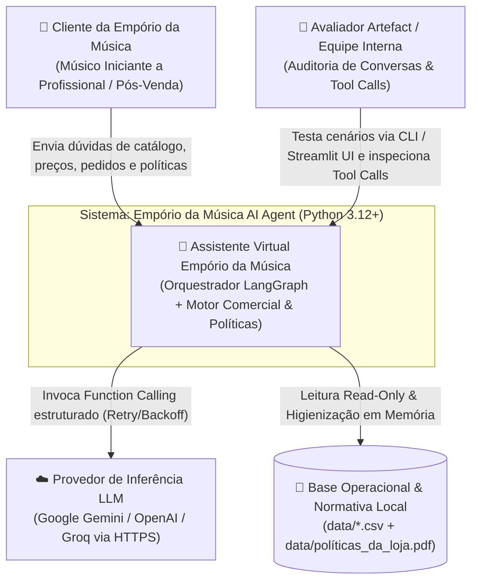
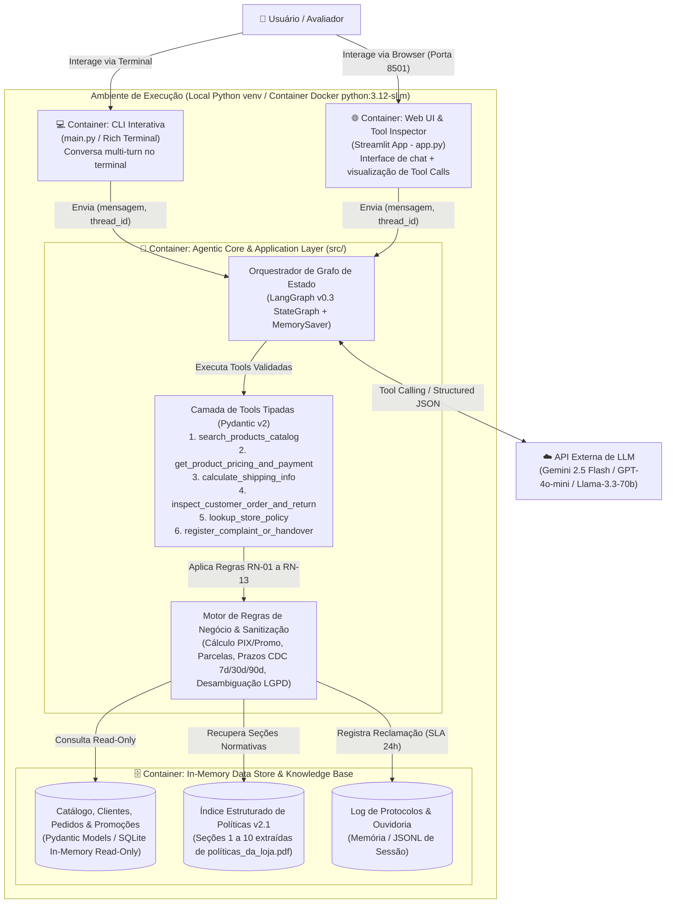

# 01 — Arquitetura de Sistemas, C4 Model e Topologia

> **Status:** Validado  
> **Data:** 2026-11-02  
> **Artefato:** `docs/architecture/01_arquitetura_sistema_c4.md`  

---

## 1. Visão Arquitetural e Estilo Adotado
O **Empório da Música AI Agent** adota o estilo **Monólito Modular Orientado a Agentes (Clean Architecture + LangGraph v0.3 StateGraph)** em **Python 3.12+**.

### Motivação de Engenharia (Zero-Friction Evaluation):
1. **Execução Imediata pelo Avaliador:** O avaliador da Artefact pode clonar o repositório, configurar a chave de API no `.env` e executar a CLI ou a Web UI (Streamlit) imediatamente com um único comando, sem depender de provisionamento de clusters externos.
2. **Desacoplamento Estrito de Camadas:** O núcleo de regras de negócio e higienização de dados (`src/domain` e `src/data`) é 100% independente do framework de LLM (`src/agent`) e das interfaces de apresentação (`src/ui` / `main.py`).
3. **Containerização Opcional (`Dockerfile` + `docker-compose.yml`):** Fornecida na raiz para reprodutibilidade determinística em qualquer SO (`python:3.12-slim`).

---

## 2. Diagramas C4 Model (Mermaid)

### 2.1 C4 Nível 1 — Diagrama de Contexto do Sistema

### 2.2 C4 Nível 2 — Diagrama de Containers e Módulos Executáveis

---

## 3. Topologia Física e Especificação de Containers

| Componente / Serviço | Runtime / Imagem Base | Porta Padrão | Persistência / Volumes | Responsabilidade Técnica |
| :--- | :--- | :--- | :--- | :--- |
| **`emporio-cli`** | `python:3.12-slim` (ou `venv` local) | N/A (STDIO) | `./data:/app/data:ro` (Read-Only) | Interface de linha de comando interativa e executor de cenários de demonstração. |
| **`emporio-web`** | `python:3.12-slim` (`streamlit run`) | `8501:8501` | `./data:/app/data:ro` (Read-Only) | Interface gráfica web com chat multi-turn, seletor de cenários de exemplo e inspetor de chamadas de ferramentas. |
| **`data-volume`** | Sistema de Arquivos Local | N/A | `data/*.csv` e `data/políticas_da_loja.pdf` | Montado estritamente como leitura (`ro`) para garantir a invariante de não-mutação dos dados originais. |
