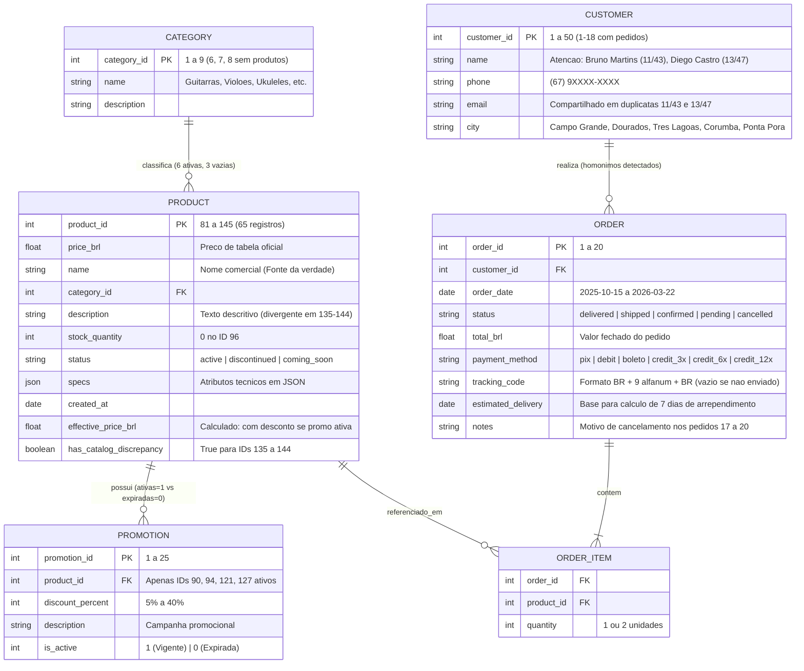

# 02 — Engenharia de Dados, Persistência e Fluxos

> **Status:** Validado  
> **Data:** 2026-11-02  
> **Artefato:** `docs/architecture/02_modelo_dados_persistencia.md`  

---

## 1. Estratégia de Persistência e Indexação (Zero-Config & Read-Only)
Para atender aos requisitos de **zero fricção na avaliação da Artefact**, **alta velocidade de resposta (`< 5s`)** e **proteção absoluta contra mutação dos CSVs originais (`W-01`)**, a camada de dados opera em dois motores complementares em memória:

1. **Dados Estruturados Operacionais (`data/*.csv`):**
   - Carregados na inicialização (Singleton Data Repository) a partir dos 6 arquivos CSV usando o módulo nativo `csv`/`sqlite3` (`:memory:`) e validados linha a linha por modelos **Pydantic v2**.
   - **Higienização e Enriquecimento em Tempo de Carga (`RN-03`, `RN-04`, `RN-05`):**
     - Cálculo prévio do campo virtual `effective_price_brl` (aplicando `discount_percent` apenas onde `promotions.is_active == 1`).
     - Geração automática da flag `has_catalog_discrepancy = True` e `discrepancy_note` para os produtos `IDs 135 a 144` (onde `name`, `description` e `specs` divergem na base bruta), garantindo que `name` e `price_brl` sejam usados como verdade comercial sem induzir o cliente a erro (CDC Art. 37).
     - Identificação explícita das categorias sem produtos (`category_id IN (6, 7, 8)`).
2. **Base de Conhecimento Normativa (`data/políticas_da_loja.pdf`):**
   - O Manual de Políticas v2.1 (8 páginas, 10 seções) é extraído via `pypdf` (com fallback determinístico estruturado em memória para as 10 seções oficiais) e indexado por tópicos semânticos e palavras-chave (`sobre_empresa`, `horario_funcionamento`, `formas_pagamento_parcelamento`, `trocas_devolucoes_arrependimento`, `frete_entregas_rastreamento`, `promocoes_descontos`, `atendimento_whatsapp_escopo`, `garantia`, `privacidade_lgpd`, `disposicoes_finais`).
3. **Memória de Conversa Multi-Turn:**
   - Gerenciada pelo `MemorySaver` nativo do **LangGraph v0.3**, isolando o estado de cada conversa por `thread_id`.

---

## 2. Diagrama Entidade-Relacionamento (Mermaid ER)

---

## 3. Dicionário de Dados & Regras de Integridade

| Entidade / Tabela | Chave Primária | Campos Indexados em Memória | Regra de Sanitização / Integridade Aplicada |
| :--- | :--- | :--- | :--- |
| `categories` | `category_id` (`int`) | `name` (normalizado sem acentos/lowercase) | Mapeia `IDs 6, 7, 8` como categorias institucionais válidas porém com `active_products_count = 0`. |
| `products` | `product_id` (`int`) | `category_id`, `status`, `name`, `effective_price_brl` | Parse seguro do campo JSON `specs`; marca `IDs 135–144` com nota de divergência técnica (`RN-03`). |
| `promotions` | `promotion_id` (`int`) | `product_id`, `is_active` | Separa promoções vigentes (`is_active == 1`) do histórico de promoções expiradas (`is_active == 0`). |
| `customers` | `customer_id` (`int`) | `name`, `phone`, `email`, `city` | Normaliza telefone (apenas dígitos) e nome para detectar homônimos/duplicatas (`RN-10`). |
| `orders` | `order_id` (`int`) | `customer_id`, `status`, `tracking_code` | Mantém `total_brl` como valor oficial contratado; converte `order_date` e `estimated_delivery` para objetos `datetime.date`. |

---

## 4. Políticas de Privacidade e Conformidade LGPD (Seção 9 do Manual)
- **Desambiguação Obrigatória de Homônimos (`RN-10`):** Quando um usuário buscar pedidos informando apenas um nome que possua múltiplos registros em `customers.csv` (ex.: `"Bruno Martins"` retorna `customer_id=11` e `customer_id=43`; `"Diego Castro"` retorna `customer_id=13` e `customer_id=47`), a camada de dados retorna `status = "AMBIGUOUS_CUSTOMER"` sem expor `orders`, exigindo confirmação de `order_id`, `phone` ou `full_name`.
- **Minimização de Dados:** A ferramenta de consulta de pedidos retorna apenas os dados estritamente necessários para o atendimento do titular verificado.
- **Imutabilidade dos Arquivos Fonte:** Nenhuma operação de escrita (`INSERT`/`UPDATE`/`DELETE`) é executada sobre os arquivos CSV em `data/`.
