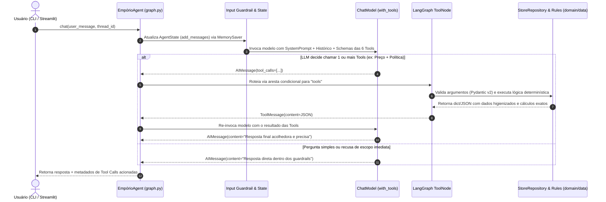

# 04 — Design Técnico Detalhado, Componentes e Segurança

> **Status:** Validado  
> **Data:** 2026-11-02  
> **Artefato:** `docs/architecture/04_design_tecnico_seguranca.md`  

---

## 1. Arquitetura em Camadas (Clean Architecture Pragmática em `src/`)

```text
src/
├── config.py                  # Carregamento seguro de variáveis de ambiente (.env) e constantes
├── domain/
│   ├── models.py              # Entidades Pydantic v2 (Category, Product, Promotion, Customer, Order, PolicySection)
│   └── rules.py               # Regras de negócio puras (Cálculo PIX/Promo, Parcelamento, Frete, Prazos CDC 7d/30d/90d)
├── data/
│   ├── repository.py          # Repositório Singleton Read-Only (Carga CSV + Sanitização IDs 135-144 + Desambiguação LGPD)
│   └── policy_kb.py           # Extrator e Indexador Semântico por Seções de data/políticas_da_loja.pdf
├── tools/
│   └── store_tools.py         # As 6 Tools tipadas com Pydantic v2 expostas ao agente (@tool)
├── agent/
│   ├── prompts.py             # System Prompt estruturado com Persona Empório da Música e Guardrails XML
│   ├── llm_factory.py         # Abstração Multi-Provider (Gemini / OpenAI / Groq) com Retry/Backoff
│   └── graph.py               # Orquestrador LangGraph v0.3 (StateGraph, AgentState, ToolNode, MemorySaver)
└── ui/
    ├── cli.py                 # Interface interativa de terminal (Rich)
    └── streamlit_app.py       # Interface Web (Streamlit) + Inspetor de Tool Calls
```

### Regras de Dependência entre Camadas:
1. **`src/domain/`** não importa nada de `langchain`, `langgraph` ou `streamlit` — contém apenas Python puro e Pydantic v2.
2. **`src/data/`** depende apenas de `src/domain/` e `src/config.py`.
3. **`src/tools/`** atua como *Adapter Layer*, conectando os schemas Pydantic de invocação do LLM às funções determinísticas de `src/domain/` e `src/data/`.
4. **`src/agent/`** orquestra o grafo de estados (`StateGraph`) usando **LangGraph v0.3+** e **LangChain v0.3+** (seguindo estritamente o runbook `langgraph-dev`: zero `AgentExecutor` legado, zero `pydantic.v1`, estado imutável com reducer `add_messages` e `MemorySaver` com `thread_id`).

---

## 2. Diagrama de Sequência Técnico Interno (LangGraph `StateGraph`)



---

## 3. Arquitetura de Segurança e Mitigações (OWASP Top 10 for LLM & LGPD)

| Vetor de Ameaça (OWASP / Legal) | Controle Arquitetural Implementado | Camada Responsável |
| :--- | :--- | :--- |
| **OWASP LLM01: Prompt Injection (Direta e Indireta)** | Delimitação clara no System Prompt tratando entradas do usuário como dados não confiáveis; proibição de sobrescrever regras comerciais ou revelar instruções internas. | `src/agent/prompts.py` |
| **OWASP LLM03 / LLM07: Excessive Agency & Insecure Tool Design** | O agente **não possui** ferramentas de escrita no banco, nem acesso a shell, nem `eval()`/`exec()`. Todas as 6 tools são funções Python estritamente tipadas via Pydantic v2 e **Read-Only** sobre `data/*.csv`. | `src/tools/store_tools.py` & `src/data/repository.py` |
| **OWASP LLM09: Misinformation / Hallucination (CDC Art. 30/37)** | Cálculos financeiros (desconto promocional, PIX 5% não cumulativo, pisos de parcelamento R\$ 50/80/100 e frete) e verificação de prazos de devolução (7d/30d/90d) são executados em Python (`src/domain/rules.py`), nunca deixados para aritmética mental do LLM. | `src/domain/rules.py` |
| **LGPD Art. 6º / Seção 9: Exposição de Dados de Homônimos** | Na consulta de pedidos por nome (`Bruno Martins` IDs 11/43, `Diego Castro` IDs 13/47), `StoreRepository.find_orders_secure()` detecta múltiplos clientes e bloqueia o retorno dos pedidos até que `order_id`, `phone`, `email` ou `city` desambigue o titular. | `src/data/repository.py` |
| **Vazamento de Credenciais (Secrets Management)** | Chaves `GEMINI_API_KEY`, `OPENAI_API_KEY` e `GROQ_API_KEY` lidas via `python-dotenv` a partir de `.env` (ignorado no `.gitignore`), fornecendo apenas `.env.example` versionado. | `src/config.py` & `.gitignore` |
