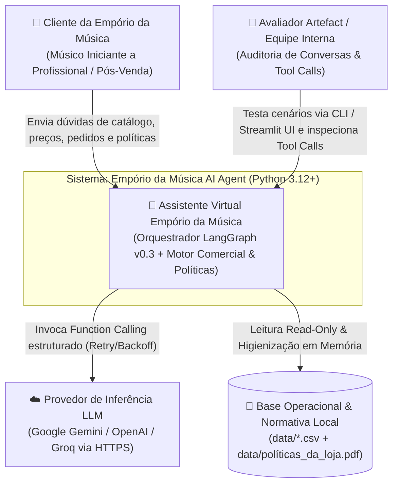
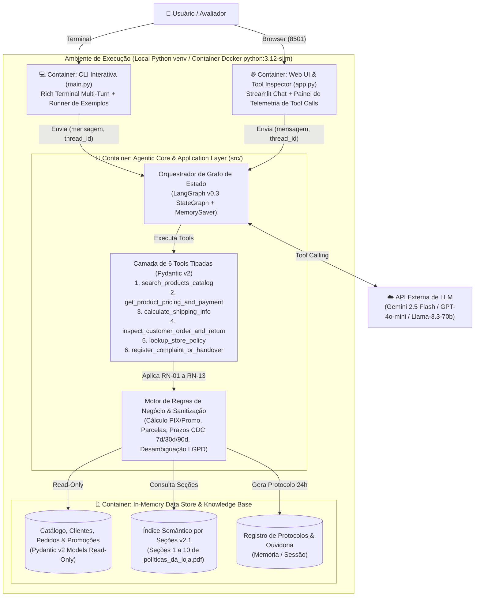
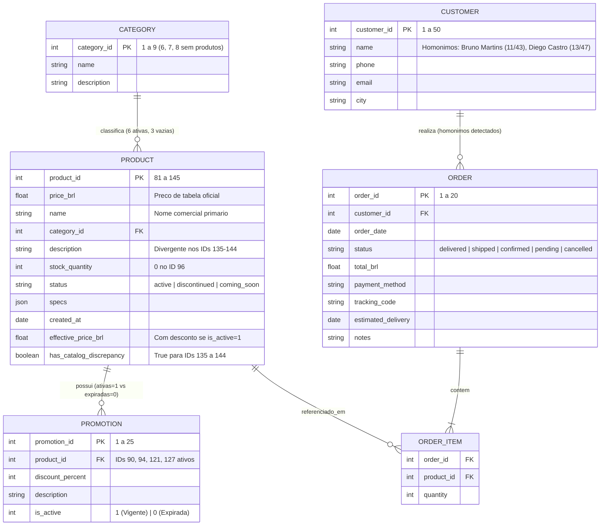

# Solution Architecture Document (SAD) — Empório da Música AI Agent

> **Projeto / Sistema:** Empório da Música AI Agent (Desafio Técnico AI Engineer — Artefact)  
> **Status:** Aguardando Aprovação no Gate 03  
> **Versão da Arquitetura:** 1.0.0  
> **Data de Atualização:** 2026-11-02  
> **Documento de Origem (Requisitos):** `docs/requirements/SRS_SOFTWARE_REQUIREMENTS_SPECIFICATION.md`  
> **Arquiteto de Software Lead:** Antigravity (SDLC Master Orchestrator) & AI Engineer  
> **Líder Técnico / Stakeholder Aprovador:** Gerência da Empório da Música & Banca Avaliadora Artefact  

---

## 1. Introdução e Contexto Arquitetural

### 1.1 Finalidade do Documento
Este documento consolida a arquitetura de software, topologia C4 Model, engenharia de dados (com sanitização não-destrutiva das anomalias dos CSVs), contratos de ferramentas (Function Calling / Pydantic v2), design em camadas (Clean Architecture + LangGraph v0.3), controles de segurança OWASP LLM Top 10 / LGPD e Architecture Decision Records (ADRs) do **Empório da Música AI Agent**.

### 1.2 Rastreabilidade com a Fase 02 (Requirements)
- **Requisitos Funcionais Atendidos:** `RF-01` a `RF-10` e Regras de Negócio `RN-01` a `RN-13`.
- **Metas de Qualidade (ISO/IEC 25010 & 25059):**
  - `RNF-01` (Fidelidade Factual): **0%** de alucinação sobre preços, estoques, promoções e status de pedidos via cálculo determinístico em código Python.
  - `RNF-02` (Desempenho): Latência de resposta **< 5s** com repositório em memória (`< 1ms` de consulta local).
  - `RNF-03` (Segurança & LGPD): Zero uso de `eval()`/`exec()`, modo estritamente Read-Only sobre `data/*.csv` e bloqueio de vazamento entre homônimos (`Bruno Martins` IDs 11/43 e `Diego Castro` IDs 13/47).
  - `RNF-04` & `RNF-05` (Resiliência & Portabilidade): Suporte multi-provider via `.env` (Gemini / OpenAI / Groq) com *Exponential Backoff* e cobertura de testes `pytest`.

---

## 2. Visão Geral da Arquitetura e C4 Model

### 2.1 C4 Model — Nível 1: Contexto do Sistema

### 2.2 C4 Model — Nível 2: Containers e Módulos Executáveis

---

## 3. Arquitetura Física, Infraestrutura e Containers (Docker & Local)

| Container / Entrypoint | Runtime / Imagem Base | Porta Mapeada | Volumes / Persistência | Comando de Execução |
| :--- | :--- | :--- | :--- | :--- |
| **`cli` (Local / Docker)** | `python:3.12-slim` | N/A (STDIO) | `./data:/app/data:ro` | `python main.py` |
| **`web` (Local / Docker)** | `python:3.12-slim` | `8501:8501` | `./data:/app/data:ro` | `streamlit run app.py` |
| **`tests` (Verificação)** | `python:3.12-slim` | N/A | `./data:/app/data:ro` | `pytest -v` |

---

## 4. Engenharia de Dados e Modelo de Persistência

### 4.1 Diagrama Entidade-Relacionamento (Mermaid ER)

### 4.2 Regras de Higienização em Memória e LGPD
- **Anomalia `IDs 135–144` (`RN-03`):** Marcados automaticamente com `has_catalog_discrepancy = True` e nota explicativa para que o agente use `name` e `price_brl` como verdade comercial e informe a observação técnica da ficha sem induzir o cliente a erro (CDC Art. 37).
- **Promoções Ativas vs. Expiradas (`RN-04`, `RN-05`):** Cálculo automático de `effective_price_brl` aplicando desconto apenas quando `is_active == 1` (`IDs 90, 94, 121, 127`).
- **Proteção LGPD contra Homônimos (`RN-10`):** Buscas por nome com múltiplos registros (`Bruno Martins`, `Diego Castro`) exigem 2º identificador antes de revelar dados do pedido.

---

## 5. Contratos de Ferramentas (Function Calling / Pydantic v2)

| ID Tool | Nome da Tool | Responsabilidade Determinística |
| :--- | :--- | :--- |
| **T-01** | `search_products_catalog` | Filtra instrumentos por categoria, termo, especificações e `max_price_brl` (sobre preço efetivo), tratando categorias vazias (`6, 7, 8`) e itens indisponíveis. |
| **T-02** | `get_product_pricing_and_payment` | Retorna preço de tabela, promoção ativa/expirada, cálculo de PIX (5% OFF não cumulativo — `RN-07`), tabela de parcelas válidas (pisos R\$ 50/80/100 e combinado > R\$ 2.000 — `RN-08`) e substitutos para indisponíveis (`RN-06`). |
| **T-03** | `calculate_shipping_info` | Calcula frete para Campo Grande/Região Metropolitana (Grátis > R\$ 500; R\$ 35 <= R\$ 500; 1–3d motoboy) e outras cidades (PAC/SEDEX/Jadlog com seguro/rastreio) + alerta de grande porte (`RN-09`). |
| **T-04** | `inspect_customer_order_and_return` | Consulta pedidos com desambiguação LGPD (`RN-10`) e avalia prazos de arrependimento (7d corridos da entrega), preferência (7d) e defeito (30d loja / 90d CDC) + exceções (`RN-11`, `RN-12`). |
| **T-05** | `lookup_store_policy` | Recupera seções completas do Manual de Políticas v2.1 (`políticas_da_loja.pdf`). |
| **T-06** | `register_complaint_or_handover` | Registra reclamação ou encaminhamento humano com código de protocolo e SLA de **24 horas úteis** (`RN-13`). |

---

## 6. Design Técnico Detalhado e Arquitetura de Segurança

### 6.1 Estrutura de Pacotes (Clean Architecture em `src/`)
- `src/config.py`: Configuração de ambiente (`.env`), caminhos e constantes.
- `src/domain/models.py` & `src/domain/rules.py`: Entidades Pydantic v2 e motor puro de cálculos comerciais, logísticos e temporais (CDC).
- `src/data/repository.py` & `src/data/policy_kb.py`: Ingestão Read-Only dos CSVs higienizados e base estruturada das 10 seções do PDF de políticas.
- `src/tools/store_tools.py`: Definição das 6 Tools com `@tool` e validação Pydantic v2.
- `src/agent/prompts.py`, `src/agent/llm_factory.py` & `src/agent/graph.py`: Grafo de estado **LangGraph v0.3 (`StateGraph`)** com `MemorySaver` e abstração multi-provider.
- `src/ui/cli.py` & `src/ui/streamlit_app.py`: Interfaces de linha de comando (`main.py`) e web (`app.py`).

### 6.2 Matriz de Segurança (OWASP LLM Top 10 & LGPD)
| Dimensão | Controle Implementado | Risco Mitigado |
| :--- | :--- | :--- |
| **Input & Prompt** | Delimitação de instrução vs. dados e recusa de comandos fora do escopo | `OWASP LLM01: Prompt Injection` |
| **Execução de Tools** | Zero `eval()`/`exec()`; Tools tipadas via Pydantic v2 e Read-Only nos CSVs | `OWASP LLM03/LLM07: Excessive Agency & RCE` |
| **Cálculo Comercial** | Funções matemáticas puras em Python para descontos, parcelas e datas | `OWASP LLM09: Hallucination / CDC Art. 37` |
| **Privacidade de Pedidos** | Bloqueio de homônimos exigindo 2º identificador (`order_id`, telefone, cidade) | `LGPD Art. 6º: Vazamento de PII` |

---

## 7. Decisões Arquiteturais Registradas (ADRs)

| ID | Título da Decisão | Status | Tecnologia / Abordagem Escolhida |
| :--- | :--- | :--- | :--- |
| **ADR-01** | Orquestração do Agente e Roteamento | APROVADO | **LangGraph v0.3 (`StateGraph`)** + 6 Tools Determinísticas Tipadas + `MemorySaver` |
| **ADR-02** | Persistência e Tratamento de Dados | APROVADO | **In-Memory Read-Only Repository** com Sanitização Pydantic v2 (Zero-Config) |
| **ADR-03** | Retrieval do Manual de Políticas | APROVADO | **Indexação Semântica por Seções Completas (1 a 10)** de `políticas_da_loja.pdf` |
| **ADR-04** | Provedor de LLM e Interfaces | APROVADO | **Multi-Provider Factory (`.env`)** (Gemini Default / OpenAI / Groq) + Dual UI (CLI & Streamlit) |

---

## 8. Portão de Decisão (Gate 03 — Architecture & Design)

### Pergunta Central de Aprovação:
> **"Temos uma solução tecnicamente coerente para atender aos requisitos?"**

### Checklist de Avaliação do Gate 03:
- [x] A arquitetura atende a todos os requisitos funcionais (`RF-01` a `RF-10`) e não-funcionais (`RNF-01` a `RNF-05`) da Fase 02?
- [x] As versões tecnológicas (Python 3.12+, LangGraph v0.3, Pydantic v2) e práticas de segurança foram validadas via pesquisa externa (`search_web`)?
- [x] O modelo C4 (Nível 1 Contexto e Nível 2 Containers) está documentado com diagramas Mermaid válidos?
- [x] A topologia de execução local e containerizada (`Dockerfile`/`docker-compose.yml`) está formalmente definida?
- [x] O modelo de dados relacional (ER) e a higienização das anomalias dos CSVs cobrem todas as entidades com integridade e proteção LGPD?
- [x] Os contratos das 6 Tools possuem schemas Pydantic v2, retornos estruturados e políticas de resiliência (Retry/Backoff)?
- [x] A estratégia de segurança contempla mitigações OWASP Top 10 for LLM e LGPD?
- [x] As 4 ADRs foram documentadas no padrão Nygard com trade-offs explícitos?
- [x] Nenhuma linha de código de aplicação foi escrita de forma prematura antes da aprovação deste Gate?

### Parecer do Gate 03:
* **Decisão:** `[ (X) APROVADO — Pronto para Fase 04 (Development & Integration) | ( ) REPROVADO / REVISÃO NECESSÁRIA ]`
* **Data da Decisão:** 2026-11-02
* **Aprovador / Lead de Arquitetura:** Usuário (AI Engineer) & Antigravity (SDLC Orchestrator)
* **Observações e Condicionantes:** Arquitetura aprovada. Contrato local `GEMINI.md` atualizado para habilitar a construção do código na Fase 04.
