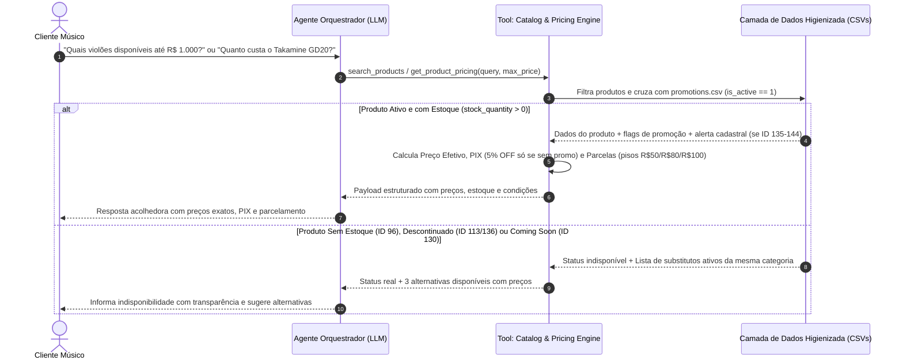
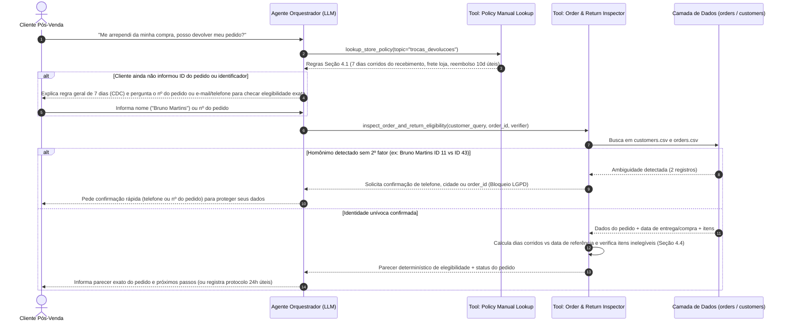

# 02 — Modelagem Funcional, User Stories e Fluxos

> **Status:** Validado  
> **Data:** 2026-11-02  
> **Artefato:** `docs/requirements/02_modelagem_funcional_fluxos.md`  

---

## 1. Épicos e User Stories (Padrão INVEST)

### Épico 1: Descoberta Consultiva de Catálogo & Motor Comercial Determinístico
*Vinculado a: `RF-01`, `RF-02`, `RF-03`, `RF-04`, `RF-05`, `RF-06`*

#### US-01 — Busca de Instrumentos por Categoria e Teto de Orçamento
- **Como** Lucas Mendes (Cliente Músico),
- **Quero** buscar instrumentos disponíveis filtrando por categoria (ex.: Violões, Ukuleles, Guitarras) e orçamento máximo (ex.: até R\$ 1.000,00), considerando descontos de promoções ativas,
- **Para que** eu visualize rapidamente todas as opções reais em estoque que cabem no meu bolso sem perder tempo com itens esgotados.

#### US-02 — Consulta de Preço, Promoções Ativas/Expiradas e Simulação de Pagamento
- **Como** Lucas Mendes (Cliente Músico),
- **Quero** consultar o preço de um modelo específico (ex.: *Takamine GD20* ou *Crafter HT-100*), sabendo se há promoção ativa (preço original + % OFF + preço final) ou se a promoção venceu, quanto fica no PIX (5% OFF apenas se não estiver em promoção) e em quantas vezes sem juros posso parcelar respeitando a parcela mínima,
- **Para que** eu tenha transparência financeira total antes de fechar a compra.

#### US-03 — Tratamento de Produtos Indisponíveis, Descontinuados, Em Breve e Divergências Cadastrais
- **Como** Lucas Mendes (Cliente Músico),
- **Quero** ser avisado com honestidade caso o instrumento buscado esteja sem estoque (`ID 96`), descontinuado (`IDs 113, 136`), em pré-lançamento (`ID 130`), em categoria sem itens (`Sopros / Cordas Orquestrais`) ou possua observação cadastral (`IDs 135–144`), recebendo sugestões imediatas de modelos equivalentes disponíveis,
- **Para que** eu não sofra com "venda fantasma" ou propaganda enganosa (CDC Art. 30/37).

---

### Épico 2: Pós-Venda Seguro, Rastreamento de Pedidos & Políticas do CDC
*Vinculado a: `RF-07`, `RF-08`, `RF-09`*

#### US-04 — Consulta Segura de Status e Rastreamento de Pedido com Desambiguação LGPD
- **Como** Fernanda / Pedro (Cliente Pós-Venda),
- **Quero** consultar o status atual, código de rastreamento (`BR...BR`), itens comprados e previsão de entrega do meu pedido mediante confirmação de identidade (`order_id` ou combinação de nome + telefone/e-mail/cidade),
- **Para que** eu acompanhe minha entrega com rapidez e sem risco de ter meus dados expostos a homônimos (`Bruno Martins`, `Diego Castro`).

#### US-05 — Avaliação Proativa de Elegibilidade de Troca, Devolução por Arrependimento e Garantia
- **Como** Fernanda / Pedro (Cliente Pós-Venda),
- **Quero** saber se posso devolver ou trocar minha compra por arrependimento (7 dias corridos do recebimento), preferência (7 dias) ou defeito (30 dias na loja / 90 dias CDC), recebendo tanto a explicação clara da política quanto a checagem automática do meu pedido específico quando eu informar o número ou meus dados,
- **Para que** eu exerça meus direitos de consumidor sabendo quem arca com o frete e o prazo de reembolso (10 dias úteis).

---

### Épico 3: Guardrails de Escopo, Ouvidoria & Experiência Conversacional Multi-Turn
*Vinculado a: `RF-01`, `RF-06`, `RF-09`, `RF-10`*

#### US-06 — Consulta de Informações Gerais, Horários, Frete e Redirecionamento de Acessórios
- **Como** Cliente da Empório da Música,
- **Quero** tirar dúvidas rápidas sobre endereço, horário de funcionamento, cálculo de frete (Campo Grande vs. outras cidades via PAC/SEDEX/Jadlog) e ser educadamente informado caso eu procure acessórios não vendidos pela loja (cordas, palhetas, cabos, cases, pedais, amplificadores),
- **Para que** eu tenha um atendimento ágil, cordial e sem respostas robóticas.

#### US-07 — Registro de Reclamações e Encaminhamento Humano com Continuidade de Sessão
- **Como** Mariana (Especialista de Atendimento Humano) e Cliente Insatisfeito,
- **Quero** que reclamações formais ou dúvidas omissas na política sejam acolhidas com empatia e registradas em um protocolo estruturado com prazo de retorno de 24 horas úteis, mantendo a sessão de conversa aberta caso o cliente tenha outras dúvidas,
- **Para que** a equipe humana receba o contexto pronto sem travar a experiência do usuário no chat.

---

## 2. Diagramas de Fluxo e Casos de Uso (Mermaid)

### 2.1 Fluxo de Consulta de Catálogo, Preços e Condições Comerciais

### 2.2 Fluxo de Pós-Venda: Consulta de Pedido (Desambiguação LGPD) e Devolução

---

## 3. Jornadas de Usuário e Pontos de Decisão
1. **Início da Jornada:** O cliente envia uma mensagem em linguagem natural (via CLI ou Web UI).
2. **Classificação de Intenção e Roteamento pelo Agente:**
   - **Intenção de Catálogo/Preço:** Aciona obrigatoriamente as tools de produto e cálculo financeiro (`RN-02`).
   - **Intenção de Política/Institucional:** Aciona a tool de consulta às seções do Manual (`políticas_da_loja.pdf`).
   - **Intenção Híbrida (ex.: Troca de pedido específico ou Frete para compra de item):** Aciona combinadamente a tool de dados e a tool de políticas.
   - **Intenção Fora de Escopo (Acessórios ou Assuntos Aleatórios):** Recusa educada imediata segundo a `RN-01`, mantendo o tom amigável da loja.
3. **Desfecho Sucesso:** Resposta clara, escaneável, acolhedora e 100% ancorada nos dados retornados pelas ferramentas.
4. **Desfecho Exceção / Reclamação:** Registro de protocolo via `register_complaint_or_handover` com SLA de 24h úteis, mantendo a sessão ativa para novas perguntas.
