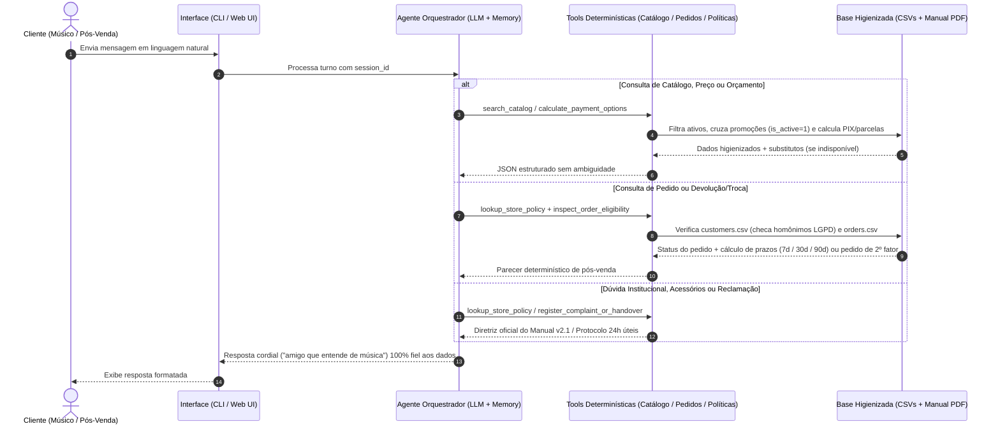

# Software Requirements Specification (SRS) — Empório da Música AI Agent

> **Projeto / Sistema:** Empório da Música AI Agent (Desafio Técnico AI Engineer — Artefact)  
> **Status:** Aguardando Aprovação no Gate 02  
> **Versão da Especificação:** 1.0.0  
> **Data de Atualização:** 2026-11-02  
> **Documento de Origem (Discovery):** `docs/discovery/PRODUCT_DISCOVERY_VISION.md`  
> **Responsável / Engenheiro de Requisitos:** Antigravity (SDLC Master Orchestrator) & AI Engineer  
> **Patrocinador / Stakeholder Aprovador:** Gerência da Empório da Música & Banca Avaliadora Artefact  

---

## 1. Introdução e Escopo do Sistema

### 1.1 Finalidade do Documento
Este documento formaliza os Requisitos Funcionais (`RF-01` a `RF-10`), Requisitos Não Funcionais segundo a norma **ISO/IEC 25010 / 25059** (`RNF-01` a `RNF-05`), Regras de Negócio (`RN-01` a `RN-13`), Modelagem Funcional (Épicos, User Stories no padrão INVEST e Diagramas de Sequência Mermaid), Priorização MoSCoW e Critérios de Aceite em formato **BDD / Gherkin** (`BDD-01` a `BDD-08`) para o **Empório da Música AI Agent**.

### 1.2 Transição do Discovery para Especificação
- **Problema Validado (Fase 01):** Sobrecarga da equipe humana no WhatsApp com perguntas repetitivas e alto risco de inconsistência comercial/jurídica devido a anomalias nos CSVs operacionais (`IDs 135–144`, categorias vazias `IDs 6–8`, promoções expiradas, produtos fora de estoque/descontinuados e clientes homônimos).
- **Proposta de Valor / Visão:** Assistente conversacional em Python com arquitetura híbrida (Tools determinísticas Read-Only sobre CSVs higienizados + consulta estruturada ao Manual de Políticas em PDF), entregando respostas precisas em `< 5s` com a persona de *"um amigo que entende de música"*.
- **Público-Alvo e Personas:**
  1. **Lucas Mendes (Persona Core — Cliente Músico):** Busca instrumentos por orçamento/categoria, preços, descontos de PIX/promoção, parcelamento e frete.
  2. **Fernanda / Pedro (Persona Secundária — Cliente Pós-Venda):** Consulta status/rastreamento de pedidos com privacidade LGPD e avalia elegibilidade de trocas/devoluções.
  3. **Mariana (Persona Secundária — Especialista de Atendimento Humano):** Recebe reclamações e casos omissos triados com protocolo e SLA de 24h úteis.

---

## 2. Requisitos Funcionais (RF)

| ID | Módulo / Domínio | Nome do Requisito | Descrição Técnica & Operacional | Prioridade | Requisito Relacionado |
| :--- | :--- | :--- | :--- | :--- | :--- |
| **RF-01** | Persona & Escopo | Identidade Conversacional e Guardrails de Domínio | Atender clientes com tom informal, acolhedor e técnico-musical (*"amigo que entende de música"*), seguindo o fluxo de 5 etapas (Saudação, Entendimento, Consulta, Resposta, Fechamento) e recusando educadamente buscas por acessórios (cordas, palhetas, cabos, cases, pedais, amplificadores) ou assuntos fora do domínio da loja. | Must Have | `RN-01`, `RN-02` |
| **RF-02** | Ingestão & Qualidade | Higienização e Saneamento dos CSVs Operacionais | Carregar `data/*.csv` em modo Read-Only na inicialização, detectando e sinalizando divergências cadastrais entre `name`, `description` e `specs` (`IDs 135–144`), mapeando categorias sem produtos (`IDs 6, 7, 8`) e vinculando promoções ativas (`is_active == 1`) vs. expiradas (`is_active == 0`). | Must Have | `RN-03`, `RN-04` |
| **RF-03** | Catálogo & Busca | Busca e Filtragem Determinística de Instrumentos | Buscar instrumentos por categoria, termo/modelo, especificações técnicas e faixa de preço máxima (`max_price_brl`), avaliando o teto de orçamento sobre o **Preço Efetivo Vigente** (já considerando descontos de promoções ativas `is_active == 1`). | Must Have | `RN-04`, `RN-05` |
| **RF-04** | Disponibilidade & Substitutos | Tratamento de Estoque Zero, Descontinuados e Em Breve | Quando um produto consultado estiver fora de estoque (`stock_quantity == 0`, ex.: `ID 96`), descontinuado (`status == 'discontinued'`, ex.: `IDs 113, 136`) ou em pré-lançamento (`status == 'coming_soon'`, ex.: `ID 130`), informar o status real com transparência e sugerir automaticamente até 3 instrumentos equivalentes disponíveis da mesma categoria. | Must Have | `RN-06` |
| **RF-05** | Motor Comercial | Cálculo de Preços, Promoções, PIX e Parcelamento | Calcular deterministicamente em Python o preço promocional (preço original + % OFF + preço final), o valor à vista no PIX (5% OFF **apenas** quando não houver promoção ativa) e a tabela de parcelamento sem juros em até 12x respeitando as parcelas mínimas por faixa (até 3x >= R\$ 50; 4x–6x >= R\$ 80; 7x–12x >= R\$ 100) e pagamento combinado (acima de R\$ 2.000). | Must Have | `RN-05`, `RN-07`, `RN-08` |
| **RF-06** | Logística & Frete | Consulta de Frete e Modalidades de Entrega | Calcular o frete para a Região Metropolitana de Campo Grande (Grátis acima de R\$ 500,00; taxa fixa de R\$ 35,00 abaixo de R\$ 500,00; prazo 1–3 dias úteis via motoboy próprio) e informar prazos/modalidades para outras cidades (PAC 5–12 dias úteis, SEDEX 2–5 dias úteis, Jadlog 3–8 dias úteis, todos com seguro e rastreamento), alertando sobre cotação especial para instrumentos de grande porte (baterias acústicas, pianos digitais, contrabaixos). | Must Have | `RN-09` |
| **RF-07** | Pós-Venda & Pedidos | Consulta Segura de Pedidos e Rastreamento (LGPD) | Consultar status, itens (`order_items.csv`), valor total (`total_brl`), código de rastreio (`tracking_code`), previsão de entrega e notas de pedidos (`orders.csv`), exigindo confirmação de um segundo identificador (`order_id`, telefone, e-mail ou cidade) quando a busca por nome retornar homônimos ou múltiplos clientes (`customers.csv`). | Must Have | `RN-10` |
| **RF-08** | Trocas, Devoluções & Garantia | Verificação Determinística de Elegibilidade (CDC & Manual) | Avaliar solicitações de devolução por arrependimento (até 7 dias corridos do recebimento, frete pela loja), troca por preferência (até 7 dias) e troca por defeito (até 30 dias na loja; até 90 dias garantia legal CDC / fabricante), confrontando as datas do pedido com uma data de referência configurável (default `2026-03-25` ou data atual) e checando itens não elegíveis (personalizados/setup, venda final de liquidação, boquilhas de sopro). | Must Have | `RN-11`, `RN-12` |
| **RF-09** | Políticas & Ouvidoria | Recuperação do Manual de Políticas e Registro de Reclamações | Consultar seções do manual `políticas_da_loja.pdf` (dados da empresa, horários, pagamentos, trocas, frete, promoções, WhatsApp, garantia, LGPD) e oferecer ferramenta `register_complaint_or_handover` para registrar reclamações ou escalonar casos omissos para a gerência/atendente humano, informando o SLA de retorno de 24 horas úteis. | Must Have / Should Have | `RN-13` |
| **RF-10** | Memória & Interfaces | Persistência de Contexto Multi-Turn e Interfaces de Interação | Manter o histórico da conversa por sessão (`session_id` / `thread_id`) para suportar diálogos encadeados e disponibilizar execução via CLI interativa e Web UI enxuta, além de exportar os 3 a 5 exemplos de conversas exigidos. | Must Have / Should Have | `RN-01` |

---

## 3. Requisitos Não Funcionais (RNF — Padrão ISO/IEC 25010 & 25059)

### 3.1 Embasamento Técnico e Normativo (Pesquisa Externa)

| Norma / Padrão / Legislação | Âmbito / Órgão Regulador | Referência Técnica | Impacto nos RNFs do Sistema |
| :--- | :--- | :--- | :--- |
| **ISO/IEC 25010 & 25059** | Internacional (ISO/IEC) | SQuaRE Quality Model for Software & AI Systems | Estruturação de Confiabilidade (Faithfulness), Eficiência de Desempenho e Segurança. |
| **CDC (Lei nº 8.078/1990)** | Brasil (Defesa do Consumidor) | Arts. 26, 30, 37 e 49 + Decreto nº 7.962/2013 | Vinculação da oferta, proibição de propaganda enganosa e prazos legais de arrependimento/garantia. |
| **LGPD (Lei nº 13.709/2018)** | Brasil (ANPD) | Art. 6º (Prevenção/Segurança) e Seção 9 do Manual | Desambiguação obrigatória de homônimos antes de exibir dados de pedidos e proteção de PII. |
| **OWASP Top 10 for LLM** | Internacional (OWASP) | LLM01 (Prompt Injection) & LLM07 (Insecure Tool Design) | Proibição de `eval()`/`exec()`, uso estrito de Tools tipadas (Pydantic) e modo Read-Only nos CSVs. |

### 3.2 Especificação Detalhada dos RNFs

| ID | Categoria (ISO 25010) | Parâmetro Mensurável | Métrica / Critério de Aceite Técnico | Prioridade |
| :--- | :--- | :--- | :--- | :--- |
| **RNF-01** | Confiabilidade (Fidelidade Factual) | Taxa de Alucinação Comercial (*Hallucination Rate*) | **0%** de alucinação sobre preços, estoques, descontos ativos e status de pedidos; **100%** dos cálculos financeiros executados por funções Python determinísticas. | Must Have |
| **RNF-02** | Desempenho (Eficiência Temporal) | Latência de Resposta por Turno | Tempo médio de resposta **< 5 segundos** por interação conversacional. | Must Have |
| **RNF-03** | Segurança (Integridade & Privacidade) | Isolamento de Execução e Desambiguação LGPD | **0** chamadas a `eval()`/`exec()` no código; **100%** de retenção de detalhes sensíveis de pedidos em caso de homônimos sem 2º fator; arquivos `data/*.csv` mantidos Read-Only. | Must Have |
| **RNF-04** | Confiabilidade (Tolerância a Falhas) | Resiliência de API e Degradação Graciosa | Suporte a **Retry com Exponential Backoff** para erros transitórios (`429`/`5xx`) da API de LLM e mensagem amigável de fallback sem expor *stack traces* brutos ao usuário. | Must Have |
| **RNF-05** | Portabilidade & Manutenibilidade | Configuração Multi-Provider e Cobertura de Testes | Linguagem **Python >= 3.10**, configuração via `.env` (Google Gemini / OpenAI / Groq) e cobertura de testes automatizados (`pytest`) em 100% das tools de negócio. | Must Have |

---

## 4. Regras de Negócio (RN)

| ID | Nome da Regra | Declaração da Regra de Negócio | Ação em Caso de Violação |
| :--- | :--- | :--- | :--- |
| **RN-01** | Exclusividade de Instrumentos Musicais | A loja comercializa exclusivamente instrumentos musicais. Acessórios (cordas, palhetas, cabos, cases, pedais, amplificadores) não são vendidos. | Informar educadamente a restrição de escopo e sugerir buscar lojas parceiras. |
| **RN-02** | Obrigatoriedade de Consulta ao Sistema | Proibido responder sobre preço, estoque, promoção ou pedido sem acionar as ferramentas do sistema. | Acionar obrigatoriamente a tool correspondente antes de formular a resposta. |
| **RN-03** | Higienização Cadastral (`IDs 135–144`) | Nos produtos `IDs 135 a 144` (com divergência entre `name`, `description` e `specs`), adotar `name` e `price_brl` como referência primária e sinalizar a observação técnica. | Alertar o cliente com transparência para nunca induzi-lo a erro (CDC Art. 37). |
| **RN-04** | Vigência e Transparência de Promoções | Apenas promoções com `is_active == 1` (`IDs de produto 90, 94, 121, 127`) estão vigentes. Sempre informar Preço Original + % de Desconto + Preço Final. | Se `is_active == 0`, informar que a promoção venceu e exibir o preço atual. |
| **RN-05** | Filtro de Orçamento por Preço Efetivo | Buscas por teto de preço (ex.: *"até R\$ 1.000"*) avaliam o **Preço Efetivo Vigente** (já aplicando desconto se `is_active == 1`). | Retornar itens cujo preço efetivo seja `<= max_price_brl` e `stock_quantity > 0`. |
| **RN-06** | Status de Disponibilidade e Alternativas | Produtos com `stock_quantity == 0` (`ID 96`), `discontinued` (`IDs 113, 136`) ou `coming_soon` (`ID 130`) não estão disponíveis para pronta entrega. Categorias `6, 7, 8` estão sem modelos em estoque no CSV. | Informar o status real e sugerir até 3 alternativas disponíveis da mesma categoria (ou oferecer encomenda/gerência para categorias `6, 7, 8`). |
| **RN-07** | Não-Cumulatividade de PIX e Promoções | O PIX à vista dá **5% de desconto** sobre o preço de tabela, mas **não acumula** com promoções ativas (`is_active == 1`). | Em produtos promocionais ativos (`IDs 90, 94, 121, 127`), manter o preço promocional sem desconto adicional de 5%. |
| **RN-08** | Parcelamento Escalonado e Pagamento Combinado | Até 12x sem juros no cartão, respeitando pisos por faixa: **1x–3x** (mín. R\$ 50/parcela); **4x–6x** (mín. R\$ 80/parcela); **7x–12x** (mín. R\$ 100/parcela). Pagamento combinado (ex.: PIX + cartão) apenas acima de **R\$ 2.000,00**. | Calcular e informar apenas as faixas de parcelamento válidas para o valor do produto. |
| **RN-09** | Política de Frete Regional vs. Nacional | Campo Grande/Região Metropolitana: **Grátis** acima de R\$ 500,00; **R\$ 35,00** abaixo de R\$ 500,00 (1–3 dias úteis via motoboy). Outras cidades: PAC (5–12 dias úteis), SEDEX (2–5 dias úteis), Jadlog (3–8 dias úteis), com rastreamento e seguro. Grande porte (baterias, pianos, contrabaixos) pode exigir frete especial. | Informar valores, prazos e alertas conforme cidade e categoria do instrumento. |
| **RN-10** | Desambiguação de Identidade em Pedidos (LGPD) | Clientes homônimos (`Bruno Martins` IDs 11/43, `Diego Castro` IDs 13/47) exigem confirmação de 2º identificador (`order_id`, telefone, e-mail ou cidade). | Reter dados sensíveis do pedido até que o 2º identificador seja fornecido. |
| **RN-11** | Prazos de Arrependimento, Preferência e Defeito | Arrependimento (online): até **7 dias corridos** do recebimento (`estimated_delivery`), frete pela loja, reembolso em até 10 dias úteis. Preferência: até **7 dias**. Defeito: até **30 dias corridos** da compra (`order_date`) na loja; até **90 dias** garantia legal CDC / fabricante. | Confrontar datas com a data de referência configurável e checar se o pedido já foi entregue (`delivered`) ou se está `pending`/`confirmed`/`cancelled`. |
| **RN-12** | Exceções de Troca e Garantias | Inelegíveis para troca: itens personalizados/setup sob encomenda, liquidação "venda final" e boquilhas de sopro (higiene). Fora da garantia: desgaste natural, mau uso, quedas, umidade, reparos de terceiros e danos estéticos. | Explicar claramente a restrição aplicável da Seção 4.4 ou 8.3 do Manual. |
| **RN-13** | Tratamento de Reclamações e Casos Omissos | Ouvir com empatia, registrar reclamação/dúvida omissa via ferramenta e encaminhar ao responsável/gerência com prazo de retorno de **24 horas úteis**. | Gerar protocolo estruturado e manter a sessão conversacional aberta. |

---

## 5. Modelagem Funcional

### 5.1 Épicos e User Stories (INVEST)
- **Épico 1 — Descoberta Consultiva de Catálogo & Motor Comercial Determinístico:**
  - **US-01 (Busca por Categoria e Orçamento):** Como Cliente Músico, quero buscar instrumentos disponíveis filtrando por categoria e orçamento máximo (considerando preço efetivo com promoção ativa), para ver opções reais em estoque.
  - **US-02 (Consulta de Preço, Promoções e Pagamento):** Como Cliente Músico, quero consultar o preço de um modelo específico, sabendo se há promoção ativa ou expirada, valor no PIX (não cumulativo) e parcelamento máximo sem juros respeitando a parcela mínima.
  - **US-03 (Transparência de Indisponibilidade e Divergências):** Como Cliente Músico, quero ser informado com honestidade se um item está sem estoque (`ID 96`), descontinuado (`IDs 113, 136`), em breve (`ID 130`), em categoria sem estoque (`IDs 6–8`) ou com observação cadastral (`IDs 135–144`), recebendo sugestões de substitutos ativos.
- **Épico 2 — Pós-Venda Seguro, Rastreamento de Pedidos & Políticas do CDC:**
  - **US-04 (Rastreamento Seguro com Desambiguação LGPD):** Como Cliente Pós-Venda, quero consultar status, código de rastreio e itens do meu pedido mediante validação de 2º identificador em caso de homônimos.
  - **US-05 (Elegibilidade de Troca, Devolução e Garantia):** Como Cliente Pós-Venda, quero saber as regras de devolução/troca e ter meu pedido verificado automaticamente quanto a status e prazos (7d arrependimento / 30d defeito / 90d CDC).
- **Épico 3 — Guardrails de Escopo, Ouvidoria & Experiência Multi-Turn:**
  - **US-06 (Informações Institucionais, Frete e Recusa de Acessórios):** Como Cliente, quero consultar endereço, horários e frete, e ser educadamente redirecionado caso procure acessórios não comercializados.
  - **US-07 (Registro de Reclamações com Continuidade de Sessão):** Como Cliente/Atendente, quero que reclamações sejam registradas em protocolo com SLA de 24h úteis mantendo a conversa ativa.

### 5.2 Casos de Uso (Mermaid Sequence Diagram)

---

## 6. Priorização do Backlog (MoSCoW)

### 6.1 Must Have (Crítico para o MVP — 53,8% do Backlog)
- [x] **M-01:** Persona Empório da Música e guardrails de escopo (recusa educada de acessórios e assuntos externos).
- [x] **M-02:** Pipeline de ingestão Read-Only e higienização das anomalias de `data/*.csv` (`IDs 135–144`, categorias vazias `6–8`, promoções ativas vs. expiradas).
- [x] **M-03:** Ferramentas determinísticas de busca de catálogo, sugestão de substitutos e cálculo financeiro (promoções, PIX não cumulativo, parcelamento escalonado).
- [x] **M-04:** Ferramenta de consulta ao Manual de Políticas (`políticas_da_loja.pdf`) e regras de frete.
- [x] **M-05:** Ferramenta de consulta de pedidos com desambiguação LGPD de homônimos e cálculo de elegibilidade de troca/devolução.
- [x] **M-06:** Persistência de histórico de conversa multi-turn por sessão + Interface CLI interativa.
- [x] **M-07:** Entregáveis obrigatórios Artefact (`README.md`, 3 a 5 exemplos de interação real e repositório Git público com commits incrementais).

### 6.2 Should Have (Importante e de alto valor diferencial — 23,1%)
- [x] **S-01:** Ferramenta `register_complaint_or_handover` gerando protocolo de reclamação/encaminhamento com SLA de 24h úteis.
- [x] **S-02:** Interface Web interativa (Streamlit) conectada ao motor do agente.
- [x] **S-03:** Suíte automatizada de testes (`pytest`) cobrindo regras de negócio e anomalias dos dados.

### 6.3 Could Have (Desejável — 7,7%)
- [x] **C-01:** Inspetor visual de chamadas de ferramentas (*Tool Call Trace*) na interface para auditoria dos avaliadores.

### 6.4 Won't Have (Fora de Escopo nesta Fase — 15,4%)
- ❌ **W-01:** Escrita/sobrescrita destrutiva nos arquivos `data/*.csv` originais.
- ❌ **W-02:** Integração externa com API oficial da Meta (WhatsApp Cloud), gateways bancários reais ou API externa dos Correios.

---

## 7. Critérios de Aceite e Cenários (BDD / Gherkin)

Os 8 cenários BDD completos estão detalhados em [`04_criterios_aceite_bdd.md`](file:///c:/Users/Raul%20Caires/Documents/Desafio%20tecnico/Desafio%20T%C3%A9cnico%20AI%20Engineer/docs/requirements/04_criterios_aceite_bdd.md), cobrindo:
1. **`BDD-01` (Catálogo & Orçamento):** Filtro de violões disponíveis até R\$ 1.000,00 pelo preço efetivo, excluindo `ID 96` (sem estoque) e `ID 113` (descontinuado).
2. **`BDD-02` (Preço & Promoção Expirada):** Consulta do *Takamine GD20* (`ID 95`, R\$ 2.199,00), informando expiração da promoção de 12% (`is_active=0`), PIX com 5% OFF (R\$ 2.089,05) e até 12x sem juros de R\$ 183,25.
3. **`BDD-03` (Promoção Ativa & Não-Cumulatividade PIX):** Consulta do *Ohana CK-20* (`ID 121`, R\$ 549,00 com 20% OFF ativo = R\$ 439,20), bloqueando desconto adicional de 5% no PIX e limitando parcelamento a 5x de R\$ 87,84 (respeitando piso de R\$ 80 na faixa 4x–6x).
4. **`BDD-04` (Políticas & Frete):** Consulta de endereço, horários de funcionamento e regras de frete (Campo Grande vs. PAC/SEDEX/Jadlog).
5. **`BDD-05` (Direito de Arrependimento & Status de Pedido):** Explicação da regra de 7 dias corridos (CDC Art. 49 / Seção 4.1) combinada com checagem de status real do pedido (`delivered` vs. `pending`/`confirmed`/`cancelled`).
6. **`BDD-06` (Segurança LGPD & Homônimos):** Bloqueio de exposição de dados em buscas por `"Bruno Martins"` ou `"Diego Castro"` até confirmação do 2º identificador.
7. **`BDD-07` (Indisponibilidade & Higienização `IDs 135–144`):** Sugestão de substitutos ativos para esgotados/descontinuados/em breve e nota de transparência cadastral para os produtos `135–144`.
8. **`BDD-08` (Guardrails de Escopo & Ouvidoria):** Recusa educada de acessórios, transparência sobre categorias `6, 7, 8` sem estoque no CSV e registro de protocolo de reclamação (24h úteis).

---

## 8. Mapeamento de Dependências e Integrações

| ID | Dependência / Interface | Tipo | Impacto no Sistema | Ponto de Contato / Contrato |
| :--- | :--- | :--- | :--- | :--- |
| **DEP-01** | Provedor de Inferência LLM (Gemini / OpenAI / Groq) | Externa | Necessário para orquestração conversacional e chamada de ferramentas (*Function Calling*). | Variáveis de ambiente em `.env` + Retry/Backoff |
| **DEP-02** | Base Operacional CSV (`data/*.csv`) | Interna | Fonte primária para categorias, produtos, promoções, clientes, pedidos e itens. | Leitura Read-Only e indexação em memória |
| **DEP-03** | Manual de Políticas (`data/políticas_da_loja.pdf`) | Interna | Fonte normativa oficial para regras de negócio, horários, pagamentos, trocas, frete e garantia. | Base de conhecimento estruturada por seções |

---

## 9. Portão de Decisão (Gate 02 — Requirements)

### Pergunta Central de Aprovação:
> **"Sabemos exatamente o que precisa ser construído e como saberemos que está correto?"**

### Checklist de Avaliação do Gate 02:
- [x] Todos os requisitos funcionais (`RF-01` a `RF-10`) estão associados a regras de negócio (`RN-01` a `RN-13`) e personas claras?
- [x] Os requisitos não funcionais (`RNF-01` a `RNF-05`) possuem parâmetros quantificáveis e mensuráveis segundo a ISO/IEC 25010?
- [x] O backlog está estritamente priorizado em MoSCoW com proporção saudável de Must Have (`53,8% < 60%`)?
- [x] Todas as regras de negócio críticas e anomalias dos CSVs (`IDs 135–144`, promoções ativas/expiradas, não-cumulatividade PIX, parcelas mínimas, homônimos LGPD, prazos de 7d/30d/90d) estão formalizadas?
- [x] Os critérios de aceite estão formalizados em BDD/Gherkin (`BDD-01` a `BDD-08`) cobrindo caminhos felizes e casos de exceção/borda?
- [x] As dependências externas e resiliência de API foram mapeadas antes da arquitetura técnica?
- [x] Nenhuma linha de código de aplicação foi implementada prematuramente antes do Gate 03?

### Parecer do Gate 02:
* **Decisão:** `[ (X) APROVADO — Pronto para Fase 02.5 (Solution Design & UI/UX) e Fase 03 (Arquitetura) | ( ) REPROVADO / REVISÃO NECESSÁRIA ]`
* **Data da Decisão:** 2026-11-02
* **Aprovador / Sponsor:** Usuário (AI Engineer / Sponsor) & Antigravity (SDLC Orchestrator)
* **Observações e Condicionantes:** Especificação aprovada com rastreabilidade ponta a ponta entre Discovery, Requisitos, Regras de Negócio e Cenários BDD.
